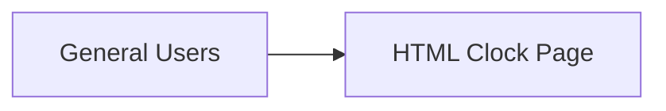

# Project Scope

| Project | Client | Version | Date |
| --- | --- | --- | --- |
| gate-way-removal | gateway | 1.0 | 2026-10-08 |

## Project Overview

The project aims to create a simple HTML page for Gateway that displays the current time in the center against a red background. This initiative is intended to meet the client's requirement for a straightforward, browser-accessible digital clock without additional features.

## Objectives

- Create an HTML page that displays the current time at the center.
- Ensure the page has a red background.

## In Scope

| Id | Capability | Description | Objective served |
|---|---|---|---|
| SCOPE-001 | HTML Clock Page Development | Development of a single HTML page displaying the current time. | Create an HTML page that displays the current time at the center. |
| SCOPE-002 | Red Background Implementation | Implementation of a red background for the HTML page. | Ensure the page has a red background. |

## Out of Scope

- Support for multiple time zones or formats, as these features are not required by the client.

## Stakeholders

| Name | Role | Organization | Contact type | Key concern |
|---|---|---|---|---|
| General Users | Users | Gateway | end user | Access to the clock display via a web browser |

## Operational Scenarios

1. **Access Clock Display** — General Users open their web browser, navigate to the HTML page, and view the current time displayed in the center against a red background.

## Assumptions

- The HTML page will be accessed only through web browsers.

## Constraints

| Type | Description |
|---|---|
| technical | The HTML page must be accessible through standard web browsers without additional plugins. |

## Risks

| Id | Description (cause → event → consequence) | Likelihood | Impact | Mitigation |
|---|---|---|---|---|
| RISK-001 | Browser compatibility issues may lead to display errors, resulting in user dissatisfaction. | medium | medium | Conduct thorough testing across major browsers to ensure compatibility. |

## Deliverables

| Deliverable | Description | Acceptance criterion |
|---|---|---|
| HTML Clock Page | A single HTML page that displays the current time centered with a red background. | The page is viewable in a web browser and meets the design specifications. |

## Technical Context

_No specific technology stack or integrations were mentioned in the RFP._

## Scope Change Control

The scope is baselined on approval; a change is raised, impact-assessed (effort, schedule, requirements affected) and approved before it is built.

## Version History

| Version | Date | Author | Changes | Status |
| --- | --- | --- | --- | --- |
| 1.0 | 2026-10-08 | ECC-SDLC | Initial draft — scope extracted from RFP/brief | Draft |
