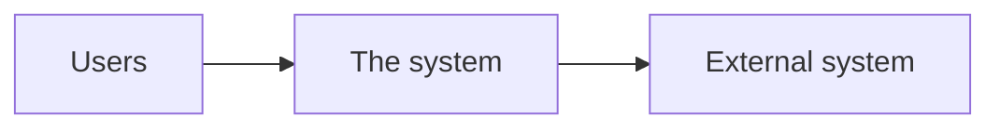

# Project Scope

| Project | Client | Version | Date |
| --- | --- | --- | --- |
| github-test | me | 1.0 | 2026-10-13 |

# Simple Static Landing Page for Guest House

## Project Overview
This project aims to develop a simple static landing page for a guest house to enhance online visibility and attract potential guests. The landing page will serve as a primary marketing tool, providing essential information about the guest house's offerings, including room details and the brand story, in a visually appealing manner.

## Objectives
- Increase online visibility and attract potential guests.
- Provide essential information about the guest house's offerings in a clear and engaging manner.

## In Scope
| Id | Capability | Description | Objective served |
|---|---|---|---|
| SCOPE-001 | Static Landing Page Development | Development of a static landing page featuring a hero section, room display section, and brand story section. | Increase online visibility and attract potential guests. |

## Out of Scope
- Booking functionality and dynamic features are excluded as the landing page will remain a static representation.

## Stakeholders
| Name | Role | Organization | Contact type |
|---|---|---|---|
| Potential Guests | End User | N/A | client sponsor |

## Assumptions
- It is assumed that all content and imagery for the landing page will be provided by the client.

## Constraints
| Type | Description |
|---|---|
| budget | The project will be constrained by a limited budget. |
| timeline | The timeline for the project has yet to be defined. |

## Risks
| Id | Description (cause → event → consequence) | Likelihood | Impact | Mitigation |
|---|---|---|---|---|
| RISK-001 | The project may face delays due to unclear content provision from the client, resulting in a delayed launch. | medium | high | Ensure clear communication with the client regarding content deadlines. |

## Deliverables
| Deliverable | Description | Acceptance criterion |
|---|---|---|
| Static Landing Page | HTML/CSS | Successful deployment and demonstration of all specified sections as outlined. |

## Scope Change Control
The scope is baselined on approval; a change is raised, impact-assessed (effort, schedule, requirements affected) and approved before it is built.

## Version History

| Version | Date | Author | Changes | Status |
| --- | --- | --- | --- | --- |
| 1.0 | 2026-10-13 | ECC-SDLC | Initial draft — scope extracted from RFP/brief | Draft |
