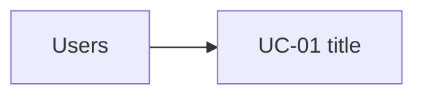
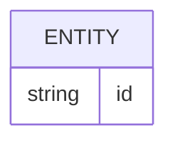

# Software Requirements Specification

| Project | Client | Version | Date |
| --- | --- | --- | --- |
| github-test | me | 1.0 | 2026-10-13 |

## 1. Introduction

### Purpose
The purpose of this Software Requirements Specification (SRS) is to outline the requirements for the development of a static landing page for a guest house. This document will serve as a reference for stakeholders to understand the goals and specifications of the project.

### Document Conventions
"shall" = binding requirement, "should" = goal, "will" = statement of fact; id scheme REQ-FUNC / REQ-NFUNC / FEAT / UC / BR; MoSCoW priorities.

### Intended Audience
This SRS is intended for the project stakeholders, including the client, project managers, developers, and testers.

### Scope
The scope of this project includes the design and development of a simple static landing page that will enhance online visibility and attract potential guests. The landing page will provide essential information about the guest house's offerings, including room details and the brand story.

### Definitions and Acronyms
| Term | Definition | Source |
|---|---|---|
| SRS | Software Requirements Specification | ISO/IEC/IEEE 29148 |
| REQ | Requirement | Project Documentation |
| FEAT | Feature | Project Documentation |
| UC | Use Case | Project Documentation |
| BR | Business Rule | Project Documentation |

### References
- ISO/IEC/IEEE 29148:2018
- Project Scope Document

## 2. Overall Description

### Product Perspective
The landing page will function as a marketing tool, providing essential information to potential guests. It will be a part of the guest house's overall online presence.

### Product Functions
The main functions of the landing page include displaying room details, a hero section, and the brand story in an engaging manner.

### User Classes
| Role | Description | Access level | Frequency |
|---|---|---|---|
| Potential Guests | End Users who will view the landing page | Read-only | As needed |

### Operating Environment
The landing page will operate in a normal web environment, accessible via standard web browsers.

### Design and Implementation Constraints
- The project will be constrained by a limited budget.
- The timeline for the project has yet to be defined.

### User Documentation
User documentation will be provided to assist in the use of the landing page.

### Assumptions and Dependencies
- It is assumed that all content and imagery for the landing page will be provided by the client.
- The project depends on timely content provision from the client.

## 3. External Interface Requirements

### User Interfaces
The landing page will be a web-based interface accessible via browsers.

### Hardware Interfaces
No specific hardware interfaces are required for the landing page.

### Software Interfaces
The system will utilize standard web technologies (HTML/CSS) for the landing page implementation.

### Communications Interfaces
No specific communications interfaces are required for the landing page.

## 4. Non-Functional Requirements

### Performance
The landing page shall load within 3 seconds on standard broadband connections.

### Safety
No specific safety requirements are applicable to the landing page.

### Security
No sensitive data will be processed on the landing page, thus no specific security measures are required.

### Reliability and Availability
The landing page shall be available 99% of the time.

### Maintainability
The landing page will be designed for easy updates and maintenance.

### Portability and Scalability
The landing page must be compatible with major web browsers.

### Usability
The landing page shall adhere to WCAG 2.2 AA accessibility standards.

### Interoperability
No interoperability requirements are stated for the landing page.

## 5. System Features

### FEAT-01 — Static Landing Page Development
The system shall develop a static landing page featuring a hero section, room display section, and brand story section. 

**Primary Actors:** Potential Guests

**Stimulus/Response Sequences:**
1. **User accesses the landing page.**
   - The system displays the hero section, room display section, and brand story section.
2. **User views the hero section.**
   - The system presents the most attractive image and text promoting the guest house.
3. **User navigates to the room display section.**
   - The system lists available rooms with descriptions and images.
4. **User reads the brand story.**
   - The system provides engaging content about the guest house's history.
5. **User interacts with page elements.**
   - The system responds to user inputs appropriately, ensuring a seamless experience.

**Preconditions:**
- The content and images must be provided by the client prior to deployment.

**Postconditions:**
- The landing page is fully functional, displaying all sections as intended.

**Owned REQ-FUNC IDs:** ["REQ-FUNC-001"]

## Requirements Catalogue

### Functional Requirements

| ID | Requirement | Priority | Feature | Acceptance criteria |
| --- | --- | --- | --- | --- |
| REQ-FUNC-001 | Static Landing Page Development | must | FEAT-01 | Given the content is provided by the client, When the landing page is accessed, Then the hero section, room display section, and brand story section are all displayed correctly. |

### Non-Functional Requirements and Constraints

_None._

## 6. Use Cases

### UC-01 — Access Landing Page

Feature (FEAT-01) · primary actor: Potential Guests · secondary actors: None · stakeholders: Client · trigger: User accesses the landing page URL · satisfied requirements: REQ-FUNC-001 · preconditions: The landing page is deployed and accessible on the web. 

1. The user opens a web browser and enters the landing page URL.
2. The system processes the request and retrieves the landing page content.
3. The system displays the hero section at the top of the landing page.
4. The system displays the room display section below the hero section.
5. The system displays the brand story section at the bottom of the landing page.

Alternate flows: None.

Exception flows: None.

Postconditions: The user successfully views the landing page with all sections displayed correctly.

## 7. Business Rules

| Id | Rule statement | Enforced by | References |
|---|---|---|---|
| BR-01 | The landing page must display all specified sections correctly when accessed. | Access Landing Page use case | REQ-FUNC-001 |

## 8. Analysis Models

### Data Models
| Entity | Attribute | Type | Required | Constraints or Allowed Values | Personal Data | Retention |
|---|---|---|---|---|---|---|
| LandingPage | id | string | Yes | Must be unique | No | Indefinitely |
| LandingPage | heroSection | string | Yes | N/A | No | Indefinitely |
| LandingPage | roomDisplay | string | Yes | N/A | No | Indefinitely |
| LandingPage | brandStory | string | Yes | N/A | No | Indefinitely |

### API Contracts
- **GET /landing-page**: Retrieves the static landing page content.
  - **Response**: 200 OK with the landing page data.

### Compliance Considerations
- The landing page must comply with relevant web accessibility standards (e.g., WCAG 2.2 AA).

## 10. TBD List
| Description | Owner | Deadline (YYYY-MM-DD) | Related REQ ids |
|---|---|---|---|
| No open items. |  |  |  |

## Version History

| Version | Date | Author | Changes | Status |
| --- | --- | --- | --- | --- |
| 1.0 | 2026-10-13 | ECC-SDLC | Initial SRS extracted from scope and validated requirements | Draft |
