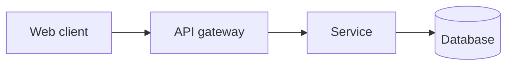

# Technical Architecture Document

| Project | Client | Version | Date |
| --- | --- | --- | --- |
| github-test | me | 1.0 | 2026-10-13 |

## 1. Context
This document outlines the technical architecture for the development of a simple static landing page for a guest house, aimed at enhancing online visibility and attracting potential guests. The architecture must consider various constraints such as budget and timeline.

| Stakeholder | Concern | Answered in |
|---|---|---|
| Client | Availability of the landing page | 4. Data Storage |
| Potential Guests | User experience | 2. Architecture Drivers |
| Developers | Build order and deployment | 3. Technology Stack |
| Client Sponsor | Budget and timeline adherence | 1. Context |

## 2. Architecture Drivers

| Driver | Source (REQ / scope) | Why it shapes the architecture |
|---|---|---|
| Performance | REQ-FUNC-001 | The landing page must load quickly (within 3 seconds) to provide a good user experience.
| Availability | Scope | The landing page must be available 99% of the time for users to access it reliably.
| Security | Scope | No sensitive data will be processed, but security measures must still be in place for user interactions.
| Usability | REQ-FUNC-001 | The landing page must adhere to WCAG 2.2 AA accessibility standards to ensure it is usable for all potential guests.

## 3. Technology Stack

| Layer | Choice | Version | Licence / build or buy | Why (REQ ids) | Alternatives considered |
|---|---|---|---|---|---|
| Client | Next.js | 13 | Open Source | Provides a robust framework for building responsive web applications | React, Vue.js |
| API | Express.js | 4.18 | Open Source | Efficient for handling requests and serving static content | Flask, Django |
| Database | N/A | N/A | N/A | No database is needed for a static landing page | SQLite, PostgreSQL |

### Environments and Deployment Topology
The landing page will be hosted on a cloud service (e.g., Vercel) and accessible via standard web browsers. There will be no separate environments as the application is static.

### High Availability and Disaster Recovery
As the application is static and hosted on a cloud platform, high availability is managed by the hosting provider, ensuring redundancy and uptime.

### Observability
Monitoring will be done through the hosting provider’s dashboard, tracking page loads and uptime metrics.

### Security Architecture
No sensitive data will be processed; however, HTTPS will be enforced for secure data transmission.

## 4. Data Storage

| Store | Kind | Holds | Why (REQ ids) |
|---|---|---|---|
| N/A | N/A | N/A | The landing page does not require a data store as it is static and only serves HTML/CSS content.

## 5. Service Boundaries
The system is a simple static landing page that does not require complex service boundaries. All content is served from the same layer without inter-service communication.

| Unit | Responsibility | Owns data | Talks to |
|---|---|---|---|
| Static Landing Page | Displays content to users | N/A | N/A |

## 6. Third-Party Services
| Service | Purpose | Requirement (REQ ids) | Alternatives considered | Integration (API, webhook, SDK) | When unavailable |
|---|---|---|---|---|---|
| N/A | N/A | N/A | N/A | N/A | N/A |

## 7. Libraries
| Library | Version | Used for | Why (REQ ids) |
|---|---|---|---|
| Next.js | 13 | Frontend framework | Provides fast rendering and easy routing for user interactions |

## 8. Architecture Decisions

### TAD-001 — Choice of Next.js for Frontend
Context: The landing page requires a modern, responsive design.
Options considered: React, Vue.js.
Decision: Next.js was chosen for its server-side rendering capabilities and ease of deployment.
Consequences: Improved load times and SEO benefits; the client must confirm the hosting provider.

### Migration and Rollback
N/A as this is a new build without legacy components.

### Risks and Technical Debt
| Risk or debt | Cause | Impact | Mitigation or repayment |
|---|---|---|---|
| Content delays | Dependency on client-provided content | High | Ensure clear communication with the client regarding content deadlines.

## 9. System Architecture

## Version History

| Version | Date | Author | Changes | Status |
| --- | --- | --- | --- | --- |
| 1.0 | 2026-10-13 | ECC-SDLC | Technical architecture decided from the approved requirements | Draft |
